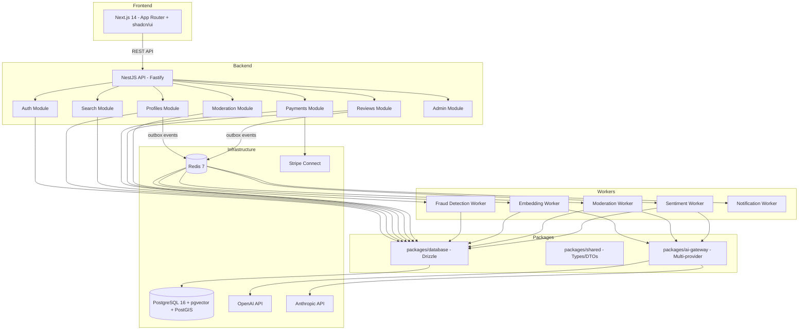

# marketplace-ai-native - Task 3

Execute task 3 for the marketplace-ai-native specification.

## Task Description
Create apps/web package.json and Next.js config

## Requirements Reference
**Requirements**: REQ-1

## Usage
```
/Task:3-marketplace-ai-native
```

## Instructions

Execute with @spec-task-executor agent the following task: "Create apps/web package.json and Next.js config"

```
Use the @spec-task-executor agent to implement task 3: "Create apps/web package.json and Next.js config" for the marketplace-ai-native specification and include all the below context.

# Steering Context
## Steering Documents Context (Pre-loaded)

### Product Context
# Product Overview

## Product Purpose
Marketplace de servicos profissionais AI-Native inspirado no Fatal Model. Conecta profissionais de servicos a clientes usando inteligencia artificial embutida em toda a experiencia — busca semantica, recomendacao, moderacao automatica, deteccao de fraude e precificacao dinamica.

## Target Users

| Role | Descricao | Necessidades |
|------|-----------|-------------|
| `professional` | Profissionais que oferecem servicos | Visibilidade, gestao de perfil, receber pagamentos, planos de assinatura |
| `user` | Clientes que buscam profissionais | Encontrar profissionais facilmente, busca inteligente, avaliacoes confiaveis |
| `moderator` | Moderadores da plataforma | Aprovar perfis, moderar fotos, resolver disputas |
| `admin` | Administrador da plataforma | Estatisticas, gestao de usuarios, configuracoes |

## Key Features

1. **Busca Semantica**: Encontra profissionais por intencao natural, nao so palavras-chave (pgvector + embeddings)
2. **Recomendacao Inteligente**: "Quem viu X tambem viu Y" baseado em comportamento real (collaborative filtering)
3. **Moderacao Automatica de Fotos**: Detecta conteudo improprio antes da aprovacao (Vision API)
4. **Deteccao de Fraude**: Identifica perfis falsos por padroes de comportamento (ML anomaly detection)
5. **Analise de Sentimento**: Extrai insights das avaliacoes dos clientes (NLP)
6. **Precificacao Dinamica**: Sugere melhor plano baseado em historico (Analytics + ML)
7. **Perfis de Profissionais**: CRUD completo com fotos, servicos, localizacao, verificacao
8. **Sistema de Pagamentos**: Stripe Connect com wallet, ledger, saques, assinaturas
9. **Avaliacoes e Reviews**: Ratings com analise de sentimento automatica
10. **Geolocalizacao**: Busca por proximidade com PostGIS

## Business Objectives

- Ser a plataforma #1 de servicos profissionais no Brasil
- Diferenciacao via IA nativa (nao bolt-on)
- Monetizacao via planos de assinatura para profissionais + comissao sobre pagamentos
- Experiencia de busca superior via IA semantica

## Success Metrics

- **GMV** (Gross Merchandise Value): Volume de transacoes na plataforma
- **Conversao de busca**: % de buscas que resultam em contato/contratacao
- **NPS**: Net Promoter Score dos profissionais e clientes
- **Tempo de busca**: Reducao do tempo medio para encontrar um profissional
- **Fraude**: Reducao de perfis falsos detectados

## Product Principles

1. **IA-First**: Toda feature deve considerar como IA pode melhorar a experiencia
2. **Simplicidade**: Interface limpa e intuitiva, complexidade escondida
3. **Confianca**: Verificacao de perfis, moderacao e deteccao de fraude como prioridade
4. **Performance**: Respostas rapidas, busca semantica < 500ms

## Monitoring & Visibility

- **Dashboard Type**: Web-based (Next.js + shadcn/ui)
- **Real-time Updates**: WebSocket para notificacoes, polling para dashboards
- **Key Metrics Displayed**: GMV, conversoes, perfis ativos, filas de moderacao, custo IA
- **Sharing Capabilities**: Reports exportaveis para admin

## Future Vision

### Potential Enhancements
- **App Mobile**: React Native para profissionais e clientes
- **Crypto Payments**: Ethereum/Polygon/Solana como alternativa
- **Agentes IA**: Assistentes autonomos com memoria persistida
- **Multi-categoria**: Expansao para novas verticais de servicos
- **Internacionalizacao**: i18n para mercados LATAM

---

### Technology Context
# Technology Stack

## Project Type
Marketplace web application full-stack com IA nativa. Monorepo com frontend, backend API, workers assincronos e pacotes compartilhados.

## Core Technologies

### Primary Language(s)
- **Language**: TypeScript 5.x (strict mode)
- **Runtime**: Node.js 20+ LTS
- **Package Manager**: pnpm 9+
- **Monorepo**: Turborepo

### Key Dependencies/Libraries

| Camada | Tecnologia | Versao | Proposito |
|--------|-----------|--------|-----------|
| Frontend | Next.js 14 | 14.x | SSR/SSG, App Router, RSC |
| UI Components | shadcn/ui | latest | Componentes acessiveis, Radix-based |
| Styling | Tailwind CSS | 3.x | Utility-first CSS |
| Backend | NestJS | 10.x | Framework modular, DI nativo |
| HTTP Adapter | Fastify | 4.x | High-performance HTTP server |
| ORM | Drizzle ORM | latest | SQL-first, queries tipadas, zero abstracao |
| Database | PostgreSQL 16 | 16.x | JSONB, extensivel, pgvector |
| Vectors | pgvector | 0.7+ | Embeddings para busca semantica |
| Geolocation | PostGIS | 3.x | Busca por proximidade geografica |
| Cache | Redis | 7.x | Rate limiting, cache, session |
| Queues | BullMQ | 5.x | Jobs assincronos (embeddings, moderacao) |
| Payments | Stripe Connect | latest | Marketplace splits, onboarding |
| AI (OpenAI) | openai | latest | GPT-4, embeddings, vision |
| AI (Anthropic) | @anthropic-ai/sdk | latest | Claude models |
| Testing | Vitest | latest | Unit + integration tests |

### Application Architecture
- **Monorepo**: Turborepo com pnpm workspaces
- **Backend**: NestJS com modulos feature-first (vertical slicing)
- **Frontend**: Next.js App Router com Server Components por padrao
- **Workers**: BullMQ processors independentes
- **AI Gateway**: Pacote isolado multi-provider (OpenAI, Anthropic, Ollama)

### Data Storage
- **Primary storage**: PostgreSQL 16 com pgvector e PostGIS
- **Caching**: Redis para rate limiting, cache, sessions
- **File storage**: S3-compatible (fotos de perfis)
- **Data formats**: JSON (API), JSONB (PostgreSQL)

### External Integrations
- **Stripe Connect**: Pagamentos, onboarding, webhooks
- **OpenAI API**: Embeddings, completions, vision
- **Anthropic API**: Claude completions
- **Ollama**: Modelos locais (fallback/dev)
- **S3**: Upload de fotos

## Development Environment

### Build & Development Tools
- **Build System**: Turborepo (parallel builds)
- **Package Management**: pnpm workspaces
- **Development workflow**: Hot reload (Next.js), watch mode (NestJS)
- **Containerization**: Docker Compose (PostgreSQL, Redis)

### Code Quality Tools
- **Static Analysis**: ESLint + TypeScript strict
- **Formatting**: Prettier
- **Testing Framework**: Vitest (unit + integration com banco real)
- **API Documentation**: OpenAPI/Swagger (NestJS decorators)

### Version Control & Collaboration
- **VCS**: Git
- **Branching Strategy**: Feature branches + main
- **Commit Format**: `feat(modulo): descricao [fase-X task-Y]`

## Technical Requirements & Constraints

### Performance Requirements
- Busca semantica: < 500ms (p95)
- API REST: < 200ms (p95)
- Busca full-text: < 100ms (p95)
- Frontend LCP: < 2.5s

### Security & Compliance
- JWT + refresh token rotativo
- RBAC com guards (admin, moderator, professional, user)
- Rate limiting per user per operation
- PII sanitizer no AI Gateway
- Audit log append-only
- LGPD compliance (dados pessoais)

### Scalability & Reliability
- Outbox pattern para eventos (zero perda)
- Circuit breaker no AI Gateway
- Retry com exponential backoff nos workers
- Optimistic locking nas wallets
- Idempotencia em operacoes financeiras

## Technical Decisions & Rationale

### Decision Log
1. **Drizzle ORM (vs TypeORM/Prisma)**: SQL-first, zero abstracao, queries tipadas sem overhead
2. **Fastify (vs Express)**: 2-3x mais rapido, schema-based validation
3. **pgvector (vs Pinecone/Weaviate)**: Sem vendor lock-in, co-located com dados, transacoes ACID
4. **BullMQ (vs Kafka/RabbitMQ)**: Simplicidade para MVP, Redis ja disponivel
5. **shadcn/ui (vs Material/Chakra)**: Componentes copiados (sem dependencia), Radix-based, altamente customizaveis
6. **Monorepo Turborepo (vs Nx/Lerna)**: Simples, rapido, zero config

## Known Limitations
- **Ollama**: Apenas para desenvolvimento local, nao para producao
- **PostGIS**: Requer extensao no PostgreSQL (incluido no Docker)
- **pgvector**: Requer tuning de indices para datasets grandes (> 1M vetores)

---

### Structure Context
# Project Structure

## Directory Organization

```
marketplace/
├── apps/
│   ├── web/                    # Next.js 14 + shadcn/ui
│   │   ├── src/
│   │   │   ├── app/            # App Router pages/layouts
│   │   │   │   ├── (auth)/     # Auth pages (login, register)
│   │   │   │   ├── (marketplace)/ # Main marketplace pages
│   │   │   │   ├── admin/      # Admin dashboard
│   │   │   │   └── api/        # API routes (BFF)
│   │   │   ├── components/     # React components
│   │   │   │   ├── ui/         # shadcn/ui base components
│   │   │   │   ├── search/     # Search-related components
│   │   │   │   ├── profiles/   # Profile components
│   │   │   │   └── ai/         # AI-powered components
│   │   │   ├── hooks/          # Custom React hooks
│   │   │   ├── lib/            # Utilities and helpers
│   │   │   └── styles/         # Global styles
│   │   ├── public/             # Static assets
│   │   ├── next.config.js
│   │   ├── tailwind.config.ts
│   │   └── package.json
│   │
│   ├── api/                    # NestJS (Fastify)
│   │   ├── src/
│   │   │   ├── modules/        # Feature modules (vertical slicing)
│   │   │   │   ├── auth/       # Auth module
│   │   │   │   │   ├── controllers/
│   │   │   │   │   ├── services/
│   │   │   │   │   ├── guards/
│   │   │   │   │   ├── strategies/
│   │   │   │   │   ├── dto/
│   │   │   │   │   └── auth.module.ts
│   │   │   │   ├── users/
│   │   │   │   ├── profiles/
│   │   │   │   ├── search/
│   │   │   │   ├── payments/
│   │   │   │   ├── reviews/
│   │   │   │   ├── moderation/
│   │   │   │   ├── subscriptions/
│   │   │   │   ├── admin/
│   │   │   │   └── webhooks/
│   │   │   ├── common/         # Shared infrastructure
│   │   │   │   ├── decorators/
│   │   │   │   ├── filters/
│   │   │   │   ├── guards/
│   │   │   │   ├── interceptors/
│   │   │   │   ├── pipes/
│   │   │   │   ├── logger/
│   │   │   │   └── metrics/
│   │   │   ├── config/         # App configuration
│   │   │   ├── app.module.ts
│   │   │   └── main.ts
│   │   ├── test/               # Integration tests
│   │   │   ├── utils/          # Test utilities
│   │   │   └── *.spec.ts
│   │   └── package.json
│   │
│   └── workers/                # BullMQ jobs
│       ├── src/
│       │   ├── processors/     # Job processors
│       │   │   ├── embedding.processor.ts
│       │   │   ├── moderation.processor.ts
│       │   │   ├── fraud-detection.processor.ts
│       │   │   ├── sentiment-analysis.processor.ts
│       │   │   └── notification.processor.ts
│       │   ├── queues.ts       # Queue definitions
│       │   └── main.ts
│       └── package.json
│
├── packages/
│   ├── database/               # Drizzle schema + migrations
│   │   ├── src/
│   │   │   ├── schema/         # Table definitions
│   │   │   │   ├── users.ts
│   │   │   │   ├── profiles.ts
│   │   │   │   ├── reviews.ts
│   │   │   │   ├── payments.ts
│   │   │   │   ├── subscriptions.ts
│   │   │   │   ├── audit-log.ts
│   │   │   │   ├── outbox.ts
│   │   │   │   ├── ai.ts       # embedding_cache, moderation_queue, fraud_scores
│   │   │   │   └── index.ts    # Re-exports
│   │   │   ├── migrations/     # SQL migrations
│   │   │   ├── seed/           # Seed data
│   │   │   └── index.ts        # DB client export
│   │   ├── drizzle.config.ts
│   │   └── package.json
│   │
│   ├── shared/                 # Types, DTOs, event schemas
│   │   ├── src/
│   │   │   ├── types/          # TypeScript interfaces
│   │   │   ├── dto/            # Data transfer objects
│   │   │   ├── events/         # Event type definitions
│   │   │   ├── enums/          # Shared enums
│   │   │   └── index.ts
│   │   └── package.json
│   │
│   ├── ai-gateway/             # Router multi-provider IA
│   │   ├── src/
│   │   │   ├── interfaces/     # AIGateway interface
│   │   │   ├── providers/      # OpenAI, Anthropic, Ollama adapters
│   │   │   ├── middleware/     # PII sanitizer, rate limiter, cache, circuit breaker
│   │   │   ├── router/         # Provider router logic
│   │   │   └── index.ts
│   │   └── package.json
│   │
│   ├── ui/                     # shadcn/ui components (shared)
│   │   ├── src/
│   │   │   └── components/
│   │   └── package.json
│   │
│   └── testing/                # Test utilities
│       ├── src/
│       │   ├── test-db.ts      # PostgreSQL test container setup
│       │   ├── fixtures/       # Test data fixtures
│       │   └── helpers/        # Test helpers
│       └── package.json
│
├── infra/
│   └── docker/                 # Docker Compose
│       ├── docker-compose.yml
│       └── init-scripts/       # PostgreSQL init (pgvector, PostGIS)
│
├── docs/
│   └── PLAN.md                 # Source of truth
│
├── turbo.json                  # Turborepo config
├── pnpm-workspace.yaml         # pnpm workspaces
├── tsconfig.base.json          # Base TypeScript config
├── .gitignore
├── CLAUDE.md                   # AI assistant rules
└── PROMPT.md                   # Ralph Loop prompt
```

## Naming Conventions

### Files
- **All files**: `kebab-case` (ex: `profile.service.ts`, `auth.controller.ts`)
- **Modules NestJS**: `{feature}.module.ts`
- **Controllers**: `{feature}.controller.ts`
- **Services**: `{feature}.service.ts`
- **Guards**: `{name}.guard.ts`
- **DTOs**: `{action}-{entity}.dto.ts` (ex: `create-profile.dto.ts`)
- **Tests**: `{filename}.spec.ts` (integration), `{filename}.test.ts` (unit)
- **React Components**: `kebab-case` files, `PascalCase` exports
- **Drizzle Schemas**: `{entity}.ts` (singular, ex: `users.ts`, `profiles.ts`)

### Code
- **Classes/Types**: `PascalCase` (ex: `ProfileService`, `CreateProfileDto`)
- **Functions/Methods**: `camelCase` (ex: `findProfileById`, `createEmbedding`)
- **Constants**: `UPPER_SNAKE_CASE` (ex: `MAX_RETRIES`, `EMBEDDING_MODEL`)
- **Variables**: `camelCase`
- **Tabelas DB**: `snake_case`, plural (ex: `users`, `profiles`, `audit_log`)
- **Eventos**: `domain.entity.action` (ex: `marketplace.profile.created`)
- **Enums**: `PascalCase` valores (ex: `UserRole.Professional`)

## Import Patterns

### Import Order
1. External dependencies (`@nestjs/*`, `drizzle-orm`, etc)
2. Internal packages (`@marketplace/database`, `@marketplace/shared`)
3. Relative imports (`./services/`, `../common/`)
4. Type-only imports (`import type { ... }`)

### Module/Package Organization
- Absolute imports via workspace aliases: `@marketplace/database`, `@marketplace/shared`, `@marketplace/ai-gateway`
- Relative imports within a module/package
- No circular dependencies between packages

## Code Structure Patterns

### NestJS Module Organization
```
modules/{feature}/
├── controllers/          # HTTP handlers
├── services/             # Business logic
├── guards/               # Authorization
├── dto/                  # Request/Response DTOs
├── entities/             # Domain entities (if needed)
├── {feature}.module.ts   # Module definition
└── index.ts              # Public exports
```

### Function Organization
- Input validation first (NestJS pipes/DTOs)
- Core logic in the middle
- Error handling via NestJS exception filters
- Early returns for edge cases

## Code Organization Principles

1. **Feature-First**: Modulos organizados por feature, nao por camada
2. **Vertical Slicing**: Cada feature contem controller + service + dto + tests
3. **Dependency Rule**: Packages nao dependem de apps, shared nao depende de database
4. **Contracts at Boundaries**: DTOs e interfaces nos limites entre modulos
5. **No Circular Dependencies**: Usar eventos do outbox para comunicacao entre modulos

## Module Boundaries

- **apps/api** → pode importar de `packages/*`
- **apps/web** → pode importar de `packages/shared`, `packages/ui`
- **apps/workers** → pode importar de `packages/database`, `packages/shared`, `packages/ai-gateway`
- **packages/database** → nao importa de outros packages
- **packages/shared** → nao importa de outros packages
- **packages/ai-gateway** → pode importar de `packages/shared`
- **packages/ui** → pode importar de `packages/shared`
- **packages/testing** → pode importar de `packages/database`

## Code Size Guidelines

- **File size**: Max 300 linhas
- **Function/Method size**: Max 30 linhas
- **Class complexity**: Max 10 metodos publicos
- **Nesting depth**: Max 3 niveis
- **Module size**: Max 15 arquivos por modulo

**Note**: Steering documents have been pre-loaded. Do not use get-content to fetch them again.

# Specification Context
## Specification Context (Pre-loaded): marketplace-ai-native

### Requirements
# Requirements Document — Marketplace AI-Native

## Introduction

Marketplace de servicos profissionais AI-Native que conecta profissionais a clientes com inteligencia artificial embutida em toda a experiencia. Inspirado no Fatal Model, o sistema oferece busca semantica, recomendacao inteligente, moderacao automatica, deteccao de fraude, analise de sentimento e precificacao dinamica.

## Alignment with Product Vision

Este projeto suporta diretamente a visao de ser a plataforma #1 de servicos profissionais no Brasil, com IA nativa desde o dia 1 (nao bolt-on). Todas as features core integram IA para melhorar a experiencia do usuario e a confianca da plataforma.

## Requirements

### REQ-1: Monorepo e Infraestrutura Base

**User Story:** As a developer, I want a well-structured monorepo with all infrastructure configured, so that I can develop features independently across apps and packages.

#### Acceptance Criteria

1. WHEN the developer runs `pnpm install` THEN the system SHALL install all workspace dependencies
2. WHEN the developer runs `pnpm dev` THEN the system SHALL start all apps in parallel with hot reload
3. WHEN the developer runs `pnpm build` THEN Turborepo SHALL build all packages and apps in correct order
4. WHEN Docker Compose starts THEN PostgreSQL 16 (with pgvector + PostGIS) and Redis SHALL be available and healthy

### REQ-2: Autenticacao e Autorizacao

**User Story:** As a user, I want to register and login securely, so that I can access the platform with my role-specific features.

#### Acceptance Criteria

1. WHEN a user registers with email/password THEN the system SHALL create an account with hashed password and default role 'user'
2. WHEN a user logs in with valid credentials THEN the system SHALL return a JWT access token and a refresh token
3. WHEN the access token expires THEN the system SHALL allow token refresh using a valid refresh token (rotativo)
4. WHEN a user with role 'user' tries to access admin endpoints THEN the system SHALL return 403 Forbidden
5. IF rate limit is exceeded THEN the system SHALL return 429 Too Many Requests

### REQ-3: Perfis de Profissionais

**User Story:** As a professional, I want to create and manage my profile with photos, services, and location, so that clients can find and evaluate me.

#### Acceptance Criteria

1. WHEN a professional creates a profile THEN the system SHALL save display name, bio, services, location, and photos
2. WHEN photos are uploaded THEN the system SHALL store them and trigger automatic moderation via AI
3. WHEN a profile is created/updated THEN the system SHALL generate embeddings via the AI Gateway
4. IF a profile has embedding THEN the system SHALL make it searchable via semantic search
5. WHEN a user views a profile THEN the system SHALL record the view for analytics and recommendations

### REQ-4: Busca (Full-text + Semantica + Geo)

**User Story:** As a user, I want to search for professionals using natural language or location, so that I can find the best match for my needs.

#### Acceptance Criteria

1. WHEN a user searches with keywords THEN the system SHALL return results using PostgreSQL FTS
2. WHEN a user searches with natural language (e.g., "quero alguem pra cortar cabelo estilo coreano") THEN the system SHALL use semantic search via pgvector
3. WHEN a user searches by location THEN the system SHALL return results ordered by proximity using PostGIS
4. WHEN search results are returned THEN the system SHALL respond within 500ms (p95)

### REQ-5: Avaliacoes e Reviews

**User Story:** As a user, I want to leave reviews for professionals, so that other users can make informed decisions.

#### Acceptance Criteria

1. WHEN a user submits a review THEN the system SHALL save rating (1-5) and comment
2. WHEN a review is created THEN the system SHALL trigger sentiment analysis via AI
3. WHEN sentiment analysis completes THEN the system SHALL store sentiment_score and sentiment_label
4. IF a review contains inappropriate content THEN the system SHALL flag it for moderation

### REQ-6: Pagamentos (Stripe Connect)

**User Story:** As a professional, I want to receive payments through the platform, so that I can monetize my services securely.

#### Acceptance Criteria

1. WHEN a professional onboards THEN the system SHALL create a Stripe Connect account
2. WHEN a payment is initiated THEN the system SHALL create a PaymentIntent with idempotency key
3. WHEN a payment succeeds THEN the system SHALL credit the professional's wallet via ledger entry
4. WHEN a professional requests a withdrawal THEN the system SHALL process it via Stripe Transfer
5. WHEN a professional subscribes to a plan THEN the system SHALL manage the subscription lifecycle

### REQ-7: AI Gateway

**User Story:** As a developer, I want all AI calls to go through a centralized gateway, so that I can manage providers, costs, and safety consistently.

#### Acceptance Criteria

1. WHEN the gateway receives a completion request THEN the system SHALL route to the best available provider
2. WHEN the gateway processes text THEN the system SHALL sanitize PII before sending to external providers
3. WHEN an embedding is requested THEN the system SHALL check semantic cache first (similarity > 0.95)
4. IF a provider is down THEN the circuit breaker SHALL fallback to the next available provider
5. WHEN any AI operation completes THEN the system SHALL track cost per operation

### REQ-8: Moderacao Automatica

**User Story:** As a moderator, I want photos to be automatically analyzed by AI, so that I only need to manually review flagged content.

#### Acceptance Criteria

1. WHEN a photo is uploaded THEN the system SHALL queue it for AI moderation
2. WHEN AI moderation detects risk > 0.7 THEN the system SHALL add it to the moderation queue
3. WHEN AI moderation detects risk < 0.7 THEN the system SHALL auto-approve the photo
4. WHEN a moderator reviews a queued item THEN the system SHALL record the decision and moderator ID

### REQ-9: Deteccao de Fraude

**User Story:** As an admin, I want the system to automatically detect suspicious profiles, so that I can maintain platform trust.

#### Acceptance Criteria

1. WHEN a new profile is created THEN the system SHALL calculate a fraud risk score
2. IF risk score > 0.8 THEN the system SHALL deactivate the profile and notify admin
3. WHEN fraud analysis runs THEN the system SHALL consider account age, verification status, and behavioral patterns

### REQ-10: Recomendacao Inteligente

**User Story:** As a user, I want to see recommended professionals based on my browsing history, so that I can discover relevant options.

#### Acceptance Criteria

1. WHEN a user views profiles THEN the system SHALL record views with source and duration
2. WHEN recommendations are requested THEN the system SHALL return similar profiles based on embedding similarity
3. WHEN "similar profiles" are requested for a profile THEN the system SHALL use collaborative filtering + embeddings

### REQ-11: Precificacao Dinamica

**User Story:** As a professional, I want the system to suggest the best subscription plan, so that I can maximize my visibility cost-effectively.

#### Acceptance Criteria

1. WHEN a professional views subscription options THEN the system SHALL suggest a plan based on their view history and engagement metrics
2. WHEN pricing suggestions are made THEN the system SHALL explain the reasoning

### REQ-12: Observabilidade

**User Story:** As a developer, I want structured logs, metrics, and audit trails, so that I can debug issues and monitor the system.

#### Acceptance Criteria

1. WHEN any operation is performed THEN the system SHALL include a correlationId in all logs
2. WHEN a state change occurs THEN the system SHALL record it in the audit log (append-only)
3. WHEN events are emitted THEN the system SHALL use the outbox pattern (never publish directly)
4. WHEN HTTP/AI/queue operations complete THEN the system SHALL record metrics (latency, cost, status)

## Non-Functional Requirements

### Performance
- Busca semantica: < 500ms (p95)
- API REST: < 200ms (p95)
- Busca full-text: < 100ms (p95)
- Frontend LCP: < 2.5s

### Security
- JWT + refresh token rotativo
- RBAC com guards por role
- Rate limiting per user per operation
- PII sanitizer no AI Gateway
- Audit log append-only
- LGPD compliance

### Reliability
- Outbox pattern para zero perda de eventos
- Circuit breaker no AI Gateway
- Retry com exponential backoff nos workers
- Optimistic locking nas wallets
- Idempotencia em operacoes financeiras

### Usability
- Interface responsiva (mobile-first)
- shadcn/ui com tema consistente
- Server Components por padrao (fast initial load)
- Busca em linguagem natural (baixa barreira de entrada)

---

### Design
# Design Document — Marketplace AI-Native

## Overview

Sistema de marketplace full-stack com IA nativa, organizado em monorepo Turborepo com 3 apps (web, api, workers) e 5 packages (database, shared, ai-gateway, ui, testing). A arquitetura segue vertical slicing no backend (NestJS) e App Router no frontend (Next.js 14).

## Steering Document Alignment

### Technical Standards (tech.md)
- Drizzle ORM SQL-first (sem abstracoes)
- Fastify adapter para NestJS (performance)
- pgvector co-located com dados (sem vendor lock-in)
- BullMQ para workers (Redis ja disponivel)
- shadcn/ui com componentes copiados (sem dependencia)
- Vitest para testes (unit + integracao com banco real)

### Project Structure (structure.md)
- `apps/api/src/modules/` — feature modules (vertical slicing)
- `apps/web/src/app/` — App Router pages
- `apps/workers/src/processors/` — job processors
- `packages/database/src/schema/` — Drizzle schemas
- `packages/shared/src/` — types, DTOs, events
- `packages/ai-gateway/src/` — AI router

## Code Reuse Analysis

### Existing Components to Leverage
- Projeto greenfield — nao ha componentes existentes para reusar
- Todos os componentes serao criados do zero seguindo os padroes definidos

### Integration Points
- **PostgreSQL**: Via Drizzle ORM (`packages/database`)
- **Redis**: Via BullMQ (`apps/workers`) e ioredis (`apps/api`)
- **Stripe**: Via Stripe SDK (`apps/api/src/modules/payments`)
- **AI Providers**: Via AI Gateway (`packages/ai-gateway`)

## Architecture



## Components and Interfaces

### Component 1: Database Package (`packages/database`)
- **Purpose:** Schema Drizzle, conexao DB, migrations
- **Interfaces:** `db` client export, schema exports, migration scripts
- **Dependencies:** `drizzle-orm`, `postgres`, `@pgvector/drizzle`
- **Reuses:** N/A (foundation layer)

### Component 2: Shared Package (`packages/shared`)
- **Purpose:** Types, DTOs, event schemas, enums compartilhados
- **Interfaces:** `UserRole`, `EventEnvelope`, DTOs tipados
- **Dependencies:** `zod` (validacao de schemas)
- **Reuses:** N/A (foundation layer)

### Component 3: AI Gateway (`packages/ai-gateway`)
- **Purpose:** Router multi-provider para chamadas de IA
- **Interfaces:** `AIGateway.complete()`, `AIGateway.createEmbedding()`, `AIGateway.analyzeImage()`
- **Dependencies:** `openai`, `@anthropic-ai/sdk`, `packages/shared`
- **Middleware:** PII Sanitizer, Rate Limiter, Semantic Cache, Circuit Breaker, Cost Tracking

### Component 4: NestJS API (`apps/api`)
- **Purpose:** Backend REST API com todos os modulos
- **Interfaces:** REST endpoints (ver seção APIs do PLAN.md)
- **Dependencies:** `packages/database`, `packages/shared`, `packages/ai-gateway`

### Component 5: Next.js Web (`apps/web`)
- **Purpose:** Frontend marketplace com SSR/RSC
- **Interfaces:** Pages (App Router), API routes (BFF)
- **Dependencies:** `packages/shared`, `packages/ui`

### Component 6: Workers (`apps/workers`)
- **Purpose:** Processadores BullMQ para tarefas assincronas
- **Interfaces:** Job processors (embedding, moderation, fraud, sentiment, notification)
- **Dependencies:** `packages/database`, `packages/shared`, `packages/ai-gateway`

## Data Models

### Users
```
users:
  - id: UUID (PK)
  - email: TEXT UNIQUE NOT NULL
  - password_hash: TEXT NOT NULL
  - role: user_role ENUM (admin, moderator, professional, user)
  - name: TEXT
  - phone: TEXT
  - document_number: TEXT UNIQUE (CPF/CNPJ hash)
  - is_verified: BOOLEAN
  - metadata: JSONB
  - created_at, updated_at, deleted_at: TIMESTAMP
```

### Profiles
```
profiles:
  - id: UUID (PK)
  - user_id: UUID (FK → users)
  - display_name, bio, description: TEXT
  - location: GEOGRAPHY(POINT) (PostGIS)
  - city, state, country: TEXT
  - services: TEXT[]
  - price_range: INT4RANGE
  - photos: TEXT[]
  - embedding: vector(1536) (pgvector)
  - is_verified, is_active: BOOLEAN
  - views_count: INT
  - search_score: FLOAT
  - created_at, updated_at: TIMESTAMP
```

### Reviews
```
reviews:
  - id: UUID (PK)
  - profile_id: UUID (FK → profiles)
  - user_id: UUID (FK → users)
  - rating: INT (1-5)
  - comment: TEXT
  - sentiment_score: FLOAT (-1 a 1)
  - sentiment_label: TEXT
  - is_moderated: BOOLEAN
  - created_at, updated_at: TIMESTAMP
```

### Payments (Stripe + Wallet + Ledger)
```
stripe_accounts: user_id → stripe_account_id, charges/payouts enabled
wallets: user_id → balance (centavos), currency, version (optimistic lock)
ledger_entries: wallet_id → amount, type (credit/debit), reason, reference_id
subscriptions: profile_id → stripe_subscription_id, plan_type, status
```

### AI Tables
```
embedding_cache: input_hash → embedding vector, model, access_count
moderation_queue: profile_id → photo_url, ai_score, ai_labels, status
fraud_scores: user_id + profile_id → risk_score, risk_factors, model_version
```

### Infrastructure Tables
```
audit_log: user_id, action, entity_type/id, old/new data, correlation_id
outbox: event_type, payload, status (pending/processed/failed), retry_count
profile_views: profile_id, viewer_id, session_id, view_duration, source
```

## Error Handling

### Error Scenarios
1. **AI Provider Down**
   - **Handling:** Circuit breaker fallback para proximo provider; se todos down, retorna resultado sem IA
   - **User Impact:** Busca degrada para full-text, moderacao fica na fila

2. **Payment Failed**
   - **Handling:** Idempotency key previne duplicacao; webhook retry
   - **User Impact:** Notificacao de falha, opcao de tentar novamente

3. **Embedding Generation Failed**
   - **Handling:** Worker retry com exponential backoff (3 tentativas)
   - **User Impact:** Perfil nao aparece em busca semantica ate retry suceder

4. **Rate Limit Exceeded**
   - **Handling:** 429 com header `Retry-After`
   - **User Impact:** Mensagem amigavel pedindo para aguardar

## Testing Strategy

### Unit Testing
- Vitest para testes unitarios de services e utilities
- Mocks apenas para dependencias externas (Stripe, AI providers)
- Coverage minimo: 80% em services

### Integration Testing
- Banco PostgreSQL real (testcontainers ou banco de teste)
- Testes end-to-end de fluxos completos (registro → login → criar perfil → buscar)
- Redis real para testes de filas

### End-to-End Testing
- Playwright para testes de UI
- Cenarios: registro, busca, perfil, pagamento, moderacao
- Testes de performance com K6 (busca semantica < 500ms p95)

**Note**: Specification documents have been pre-loaded. Do not use get-content to fetch them again.

## Task Details
- Task ID: 3
- Description: Create apps/web package.json and Next.js config
- Requirements: REQ-1

## Instructions
- Implement ONLY task 3: "Create apps/web package.json and Next.js config"
- Follow all project conventions and leverage existing code
- Mark the task as complete using: claude-code-spec-workflow get-tasks marketplace-ai-native 3 --mode complete
- Provide a completion summary
```

## Task Completion
When the task is complete, mark it as done:
```bash
claude-code-spec-workflow get-tasks marketplace-ai-native 3 --mode complete
```

## Next Steps
After task completion, you can:
- Execute the next task using /marketplace-ai-native-task-[next-id]
- Check overall progress with /spec-status marketplace-ai-native
