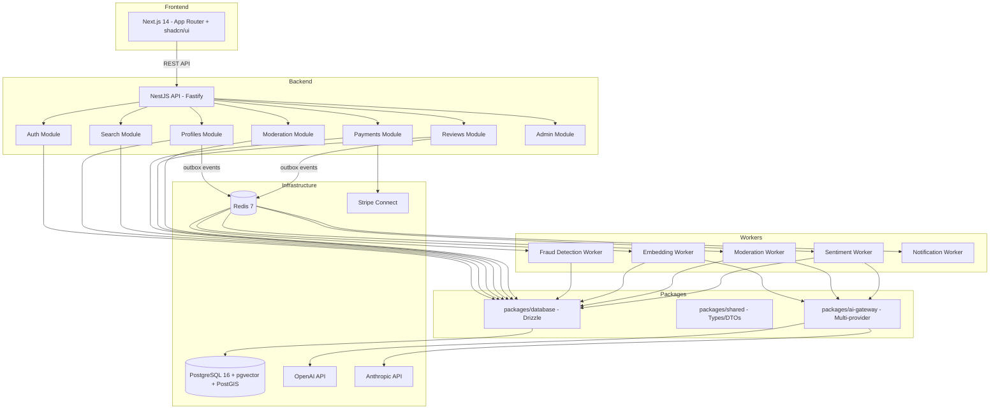

# Design Document — Marketplace AI-Native

## Overview

Sistema de marketplace full-stack com IA nativa, organizado em monorepo Turborepo com 3 apps (web, api, workers) e 5 packages (database, shared, ai-gateway, ui, testing). A arquitetura segue vertical slicing no backend (NestJS) e App Router no frontend (Next.js 14).

## Steering Document Alignment

### Technical Standards (tech.md)
- Drizzle ORM SQL-first (sem abstracoes)
- Fastify adapter para NestJS (performance)
- pgvector co-located com dados (sem vendor lock-in)
- BullMQ para workers (Redis ja disponivel)
- shadcn/ui com componentes copiados (sem dependencia)
- Vitest para testes (unit + integracao com banco real)

### Project Structure (structure.md)
- `apps/api/src/modules/` — feature modules (vertical slicing)
- `apps/web/src/app/` — App Router pages
- `apps/workers/src/processors/` — job processors
- `packages/database/src/schema/` — Drizzle schemas
- `packages/shared/src/` — types, DTOs, events
- `packages/ai-gateway/src/` — AI router

## Code Reuse Analysis

### Existing Components to Leverage
- Projeto greenfield — nao ha componentes existentes para reusar
- Todos os componentes serao criados do zero seguindo os padroes definidos

### Integration Points
- **PostgreSQL**: Via Drizzle ORM (`packages/database`)
- **Redis**: Via BullMQ (`apps/workers`) e ioredis (`apps/api`)
- **Stripe**: Via Stripe SDK (`apps/api/src/modules/payments`)
- **AI Providers**: Via AI Gateway (`packages/ai-gateway`)

## Architecture



## Components and Interfaces

### Component 1: Database Package (`packages/database`)
- **Purpose:** Schema Drizzle, conexao DB, migrations
- **Interfaces:** `db` client export, schema exports, migration scripts
- **Dependencies:** `drizzle-orm`, `postgres`, `@pgvector/drizzle`
- **Reuses:** N/A (foundation layer)

### Component 2: Shared Package (`packages/shared`)
- **Purpose:** Types, DTOs, event schemas, enums compartilhados
- **Interfaces:** `UserRole`, `EventEnvelope`, DTOs tipados
- **Dependencies:** `zod` (validacao de schemas)
- **Reuses:** N/A (foundation layer)

### Component 3: AI Gateway (`packages/ai-gateway`)
- **Purpose:** Router multi-provider para chamadas de IA
- **Interfaces:** `AIGateway.complete()`, `AIGateway.createEmbedding()`, `AIGateway.analyzeImage()`
- **Dependencies:** `openai`, `@anthropic-ai/sdk`, `packages/shared`
- **Middleware:** PII Sanitizer, Rate Limiter, Semantic Cache, Circuit Breaker, Cost Tracking

### Component 4: NestJS API (`apps/api`)
- **Purpose:** Backend REST API com todos os modulos
- **Interfaces:** REST endpoints (ver seção APIs do PLAN.md)
- **Dependencies:** `packages/database`, `packages/shared`, `packages/ai-gateway`

### Component 5: Next.js Web (`apps/web`)
- **Purpose:** Frontend marketplace com SSR/RSC
- **Interfaces:** Pages (App Router), API routes (BFF)
- **Dependencies:** `packages/shared`, `packages/ui`

### Component 6: Workers (`apps/workers`)
- **Purpose:** Processadores BullMQ para tarefas assincronas
- **Interfaces:** Job processors (embedding, moderation, fraud, sentiment, notification)
- **Dependencies:** `packages/database`, `packages/shared`, `packages/ai-gateway`

## Data Models

### Users
```
users:
  - id: UUID (PK)
  - email: TEXT UNIQUE NOT NULL
  - password_hash: TEXT NOT NULL
  - role: user_role ENUM (admin, moderator, professional, user)
  - name: TEXT
  - phone: TEXT
  - document_number: TEXT UNIQUE (CPF/CNPJ hash)
  - is_verified: BOOLEAN
  - metadata: JSONB
  - created_at, updated_at, deleted_at: TIMESTAMP
```

### Profiles
```
profiles:
  - id: UUID (PK)
  - user_id: UUID (FK → users)
  - display_name, bio, description: TEXT
  - location: GEOGRAPHY(POINT) (PostGIS)
  - city, state, country: TEXT
  - services: TEXT[]
  - price_range: INT4RANGE
  - photos: TEXT[]
  - embedding: vector(1536) (pgvector)
  - is_verified, is_active: BOOLEAN
  - views_count: INT
  - search_score: FLOAT
  - created_at, updated_at: TIMESTAMP
```

### Reviews
```
reviews:
  - id: UUID (PK)
  - profile_id: UUID (FK → profiles)
  - user_id: UUID (FK → users)
  - rating: INT (1-5)
  - comment: TEXT
  - sentiment_score: FLOAT (-1 a 1)
  - sentiment_label: TEXT
  - is_moderated: BOOLEAN
  - created_at, updated_at: TIMESTAMP
```

### Payments (Stripe + Wallet + Ledger)
```
stripe_accounts: user_id → stripe_account_id, charges/payouts enabled
wallets: user_id → balance (centavos), currency, version (optimistic lock)
ledger_entries: wallet_id → amount, type (credit/debit), reason, reference_id
subscriptions: profile_id → stripe_subscription_id, plan_type, status
```

### AI Tables
```
embedding_cache: input_hash → embedding vector, model, access_count
moderation_queue: profile_id → photo_url, ai_score, ai_labels, status
fraud_scores: user_id + profile_id → risk_score, risk_factors, model_version
```

### Infrastructure Tables
```
audit_log: user_id, action, entity_type/id, old/new data, correlation_id
outbox: event_type, payload, status (pending/processed/failed), retry_count
profile_views: profile_id, viewer_id, session_id, view_duration, source
```

## Error Handling

### Error Scenarios
1. **AI Provider Down**
   - **Handling:** Circuit breaker fallback para proximo provider; se todos down, retorna resultado sem IA
   - **User Impact:** Busca degrada para full-text, moderacao fica na fila

2. **Payment Failed**
   - **Handling:** Idempotency key previne duplicacao; webhook retry
   - **User Impact:** Notificacao de falha, opcao de tentar novamente

3. **Embedding Generation Failed**
   - **Handling:** Worker retry com exponential backoff (3 tentativas)
   - **User Impact:** Perfil nao aparece em busca semantica ate retry suceder

4. **Rate Limit Exceeded**
   - **Handling:** 429 com header `Retry-After`
   - **User Impact:** Mensagem amigavel pedindo para aguardar

## Testing Strategy

### Unit Testing
- Vitest para testes unitarios de services e utilities
- Mocks apenas para dependencias externas (Stripe, AI providers)
- Coverage minimo: 80% em services

### Integration Testing
- Banco PostgreSQL real (testcontainers ou banco de teste)
- Testes end-to-end de fluxos completos (registro → login → criar perfil → buscar)
- Redis real para testes de filas

### End-to-End Testing
- Playwright para testes de UI
- Cenarios: registro, busca, perfil, pagamento, moderacao
- Testes de performance com K6 (busca semantica < 500ms p95)
